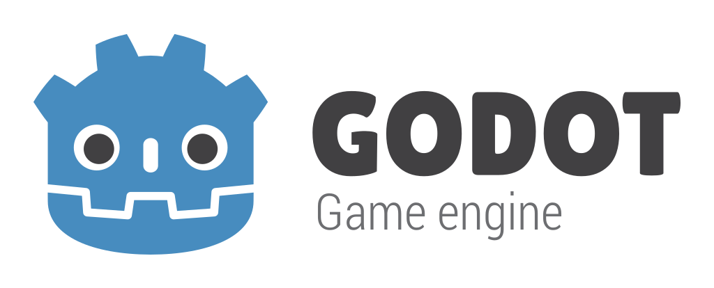

# Acknowledgements 
I (dwarfthe34) used some rendering code from the [xsdk](https://github.com/xenosworks/xsdk/),
and I used a tool known as OpenCode to help patch bugs and make rendering work.

# Documentation 
There is documentation for controller input in the [Xbox360 controller input file](./XBOX360_CONTROLLER_INPUT.md)

Build and packaging instructions are in [README_XBOX360.md](./README_XBOX360.md).

# Important
***IF YOU TEST THE GAME YOU MADE ON A REAL 360 THERE WILL BE FLASHING LGHTS***
The result may not look good at all and that is something I need to fix.
To make a game you need to compile this (if you want you can compile with ``tools=yes`` to get the GUI
then compile with ``tools=no`` to get the .ppc), make a Godot 3.6.3 project and export it (doesn't really matter if you export for Windows, Linux or anything else)
just make sure you get the ``.pck`` file, then you need to combine the ``.pck`` and ``.ppc`` file (an example could be ``cat game.pck godot-xbox-360.ppc > game.elf``)
and then make the elf file a ``.xex`` (my favorite method is [XexTool](https://github.com/Team-Resurgent/XexTool)) and a alternative method can be found in [README_XBOX360.md](./README_XBOX360.md).
## Original Godot README.md

 
# Godot Engine

  

## 2D and 3D cross-platform game engine

**[Godot Engine](https://godotengine.org) is a feature-packed, cross-platform
game engine to create 2D and 3D games from a unified interface.** It provides a
comprehensive set of [common tools](https://godotengine.org/features), so that users can focus on making games
without having to reinvent the wheel. Games can be exported with one click to a
number of platforms, including the major desktop platforms (Linux, macOS,
Windows), mobile platforms (Android, iOS), as well as Web-based platforms
(HTML5) and
[consoles](https://docs.godotengine.org/en/latest/tutorials/platform/consoles.html).

## Free, open source and community-driven

Godot is completely free and open source under the very permissive [MIT license](https://godotengine.org/license).
No strings attached, no royalties, nothing. The users' games are theirs, down
to the last line of engine code. Godot's development is fully independent and
community-driven, empowering users to help shape their engine to match their
expectations. It is supported by the [Software Freedom Conservancy](https://sfconservancy.org/)
not-for-profit.

Before being open sourced in [February 2014](https://github.com/godotengine/godot/commit/0b806ee0fc9097fa7bda7ac0109191c9c5e0a1ac),
Godot had been developed by [Juan Linietsky](https://github.com/reduz) and
[Ariel Manzur](https://github.com/punto-) (both still maintaining the project) for several
years as an in-house engine, used to publish several work-for-hire titles.

## Getting the engine

### Binary downloads

Official binaries for the Godot editor and the export templates can be found
[on the homepage](https://godotengine.org/download).

### Compiling from source

[See the official docs](https://docs.godotengine.org/en/latest/development/compiling/)
for compilation instructions for every supported platform.

## Community and contributing

Godot is not only an engine but an ever-growing community of users and engine
developers. The main community channels are listed [on the homepage](https://godotengine.org/community).

The best way to get in touch with the core engine developers is to join the
[Godot Contributors Chat](https://chat.godotengine.org).

To get started contributing to the project, see the [contributing guide](CONTRIBUTING.md).

## Documentation and demos

The official documentation is hosted on [ReadTheDocs](https://docs.godotengine.org).
It is maintained by the Godot community in its own [GitHub repository](https://github.com/godotengine/godot-docs).

The [class reference](https://docs.godotengine.org/en/latest/classes/)
is also accessible from the Godot editor.

We also maintain official demos in their own [GitHub repository](https://github.com/godotengine/godot-demo-projects)
as well as a list of [awesome Godot community resources](https://github.com/godotengine/awesome-godot).

There are also a number of other
[learning resources](https://docs.godotengine.org/en/latest/community/tutorials.html)
provided by the community, such as text and video tutorials, demos, etc.
Consult the [community channels](https://godotengine.org/community)
for more information.

